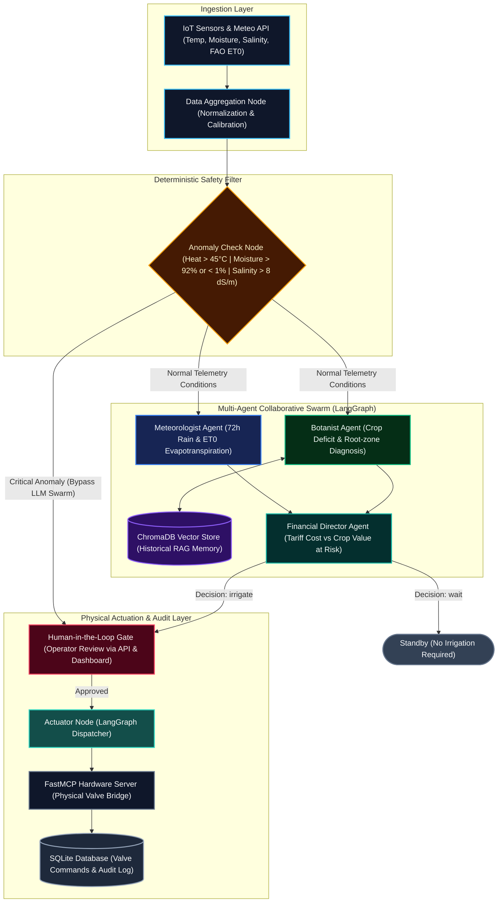

# Agri-Agent Swarm

[](https://github.com/mn1tchA/agri-agent/actions/workflows/ci.yml)
[](https://www.python.org/)
[](https://fastapi.tiangolo.com/)
[](https://react.dev/)
[](https://langchain-ai.github.io/langgraph/)
[](https://modelcontextprotocol.io/)
[]()

Autonomous multi-agent precision agriculture platform designed for water-stressed environments. The system orchestrates specialized agent swarms (meteorological forecasting, agronomic stress evaluation, and financial cost-benefit modeling) with deterministic sensor safety gates, vector memory retrieval, satellite evapotranspiration data, and Model Context Protocol (MCP) physical actuation.

---

## Problem Statement

Mediterranean and North African agricultural regions face unprecedented structural water deficits:

| Year | Per-Capita Renewable Water Availability | Context |
|:---|:---|:---|
| 1962 | 1,500 m³ / person / year | Baseline post-independence |
| 2000 | 720 m³ / person / year | Below international water poverty line |
| **2050 (Projected)** | **220 m³ / person / year** | Severe structural scarcity |

Agriculture accounts for over **70% of total national freshwater withdrawals** in Algeria. Conventional irrigation schedules rely primarily on static calendar intervals or visual soil inspection, leading to substantial over-irrigation during humid periods and under-irrigation during extreme heat anomalies.

Inspired by vertical farming automation initiatives in Mascara, Algeria, Agri-Agent Swarm implements an end-to-end autonomous decision loop that optimizes irrigation volume against real-time physical constraints, satellite water productivity indices, and energy/water tariffs.

---

## System Architecture



### Execution Lifecycle

1. **Telemetry Ingestion & Satellite Indexing**: Fetches hyper-local meteorological forecasts and computes FAO-56 Penman-Monteith reference evapotranspiration ($ET_0$), providing a direct satellite proxy for regional water productivity.
2. **Deterministic Safety Filter**: Before any LLM inference occurs, `anomaly_check_node` verifies telemetry against physical thresholds. Critical sensor failure, flooding, or heatwaves route straight to manual review, preventing costly API usage and eliminating hallucination risks during physical emergencies.
3. **Concurrent Swarm Fan-Out**: The Meteorologist and Botanist agents execute concurrently in LangGraph:
   - **Meteorologist**: Analyzes atmospheric drying potential and 72-hour rain probability.
   - **Botanist**: Retrieves historical crop analogues from ChromaDB vector memory, assesses root-zone moisture deficit, and calculates salinity stress.
4. **Economic Synthesis**: The Financial Director balances water cost (DZD/L) against estimated crop value at risk (DZD/m²) to determine the minimum effective irrigation volume.
5. **Human-in-the-Loop (HITL) Checkpoint**: If irrigation or anomaly handling is recommended, LangGraph halts execution at an interrupt breakpoint and stores state in SQLite until authenticated human approval is received.
6. **Physical Actuation via MCP**: Upon operator sign-off, the actuator dispatches commands to the FastMCP hardware bridge. Commands, timestamps, and valve telemetry are persisted to SQLite.

---

## Technical Design Decisions

### LangGraph Stateful Durable Execution
Standard LLM agent frameworks lack state serialization across disconnected HTTP requests. LangGraph provides directed acyclic graph (DAG) routing with durable SQLite checkpointers, allowing execution to pause indefinitely at a human approval gate and resume without context loss.

### Model Context Protocol (MCP) Hardware Layer
Rather than tightly coupling proprietary PLC or microcontroller code to the AI backend, actuation is exposed as an MCP server (`mcp_server.py`). Any MCP-compatible agent or orchestrator can inspect valve health, issue flow commands, or trigger emergency halts through standardized protocol primitives.

### Pre-Inference Deterministic Anomaly Gate
Running LLM inference during a hardware emergency (e.g., sensor short-circuit or irrigation pipe rupture) introduces latency and risks hallucinated approvals. Deterministic validation stops catastrophic hardware actions instantly at zero API cost.

### FAO-56 Penman-Monteith Evapotranspiration
Instead of hardcoding crop water requirements, the pipeline integrates live $ET_0$ calculations based on the FAO-56 Penman-Monteith equation via Open-Meteo. This replicates the scientific foundation of the FAO WaPOR platform without requiring external proprietary API keys.

---

## Project Structure

```
agri-agent/
├── .github/
│   └── workflows/
│       └── ci.yml             # GitHub Actions CI/CD (lint, test, build, audit)
├── alembic/                   # Database version migration environment
├── alembic.ini                # Alembic configuration (SQLite batch mode)
│
├── backend/                   # Core Python application package
│   ├── __init__.py
│   ├── alerting.py            # Alert delivery engine (DB, Webhook, SMTP)
│   ├── api.py                 # FastAPI application, lifespan & /api/v1 routes
│   ├── config.py              # Centralized pydantic-settings configuration
│   ├── database.py            # SQLModel schema definitions and CRUD layer
│   ├── graph.py               # LangGraph state machine and DAG compilation
│   ├── main.py                # Standalone CLI entrypoint
│   ├── mcp_server.py          # FastMCP hardware actuation server
│   ├── memory.py              # ChromaDB vector store with crop metadata filters
│   ├── nodes.py               # Swarm agent logic & structured output schemas
│   ├── observability.py       # Prometheus metrics & OpenTelemetry SDK setup
│   ├── scheduler.py           # APScheduler background surveillance daemon
│   ├── security.py            # OAuth2 password hashing and JWT access controls
│   └── state.py               # TypedDict state contracts across graph nodes
│
├── agri-dashboard/            # React 19 + TypeScript frontend application
│   ├── src/
│   │   ├── api/               # API client with automatic JWT token injection
│   │   ├── components/        # Reusable UI components (Header, Gate, Timeline)
│   │   ├── pages/             # Route views (Login, Dashboard, Analytics, Farms)
│   │   ├── store/             # Zustand global state (AuthStore, FarmStore)
│   │   └── types/             # Frontend TypeScript interfaces
│   ├── package.json
│   └── vite.config.ts         # Vite server proxy to backend port 8000
│
├── scripts/                   # Verification and maintenance utilities
├── tests/                     # Pytest suite (77 tests, >=70% coverage gate)
│
├── docker-compose.yml         # Container composition manifest
├── Dockerfile.backend         # Python backend container build
├── Dockerfile.frontend        # Frontend build with Nginx SPA routing
├── pyproject.toml             # Python tooling (Ruff, Mypy, Pytest, Coverage)
├── requirements.txt           # Pinned application dependencies
├── .env.example               # Environment variable reference
└── .gitignore                 # Exclusion list for credentials, DBs, and artifacts
```

---

## Technology Stack

| Domain | Component | Technology |
|:---|:---|:---|
| **Backend Framework** | Web API | FastAPI 0.136, Uvicorn (ASGI) |
| **Agent Orchestration** | Graph / Swarm | LangGraph 1.2, LangChain Core |
| **LLM Inference** | Structured Extraction | Groq (`qwen/qwen3.8-27b`) / Google Gemini 2.5 Flash |
| **Database & ORM** | Data Persistence | SQLModel 0.0.38, SQLite, aiosqlite |
| **Schema Migrations** | Version Control | Alembic (Batch Mode) |
| **Vector Memory** | Context Retrieval | ChromaDB 1.5, Sentence-Transformers (`all-MiniLM-L6-v2`) |
| **Hardware Standard** | Physical Actuation | FastMCP 2.0 (Model Context Protocol) |
| **Background Tasks** | Scheduled Monitoring | APScheduler 3.10 (`AsyncIOScheduler`) |
| **Observability** | Metrics & Tracing | Prometheus Client, OpenTelemetry SDK, LangSmith |
| **Frontend Application** | User Interface | React 19, TypeScript, TailwindCSS v4, Recharts |
| **State Management** | Client Stores | Zustand 5 |
| **Routing** | Client Routing | React Router 7 |
| **DevOps & QA** | Tooling & CI/CD | Docker, Docker Compose, GitHub Actions, Pytest, Ruff, Mypy |

---

## Getting Started

### Prerequisites

- Python 3.11+
- Node.js 20+ and npm
- (Optional) Docker and Docker Compose

### 1. Environment Configuration

Copy the sample environment file and configure credentials:

```bash
cp .env.example .env
```

Primary variables:

```ini
# LLM Provider Configuration
LLM_PROVIDER=groq
GROQ_API_KEY=your_groq_api_key
GROQ_MODEL=qwen/qwen3.8-27b

# Vector Memory & Fallback Embeddings
GOOGLE_API_KEY=your_google_ai_key

# Authentication Security
JWT_SECRET_KEY=generate_a_random_32_byte_hex_key
ACCESS_TOKEN_EXPIRE_MINUTES=60

# Default Credentials (bootstrap)
ADMIN_USERNAME=admin
ADMIN_PASSWORD=changeme
VIEWER_USERNAME=viewer
VIEWER_PASSWORD=viewer123
```

### 2. Database Migrations

Apply versioned Alembic migrations to set up SQLite schemas:

```bash
alembic upgrade head
```

### 3. Local Development

**Backend API Server:**
```bash
pip install -r requirements.txt
uvicorn api:app --app-dir backend --reload --port 8000
```
- API Base: `http://localhost:8000`
- Swagger Documentation: `http://localhost:8000/docs`
- Prometheus Metrics: `http://localhost:8000/metrics`

**Frontend Dashboard:**
```bash
cd agri-dashboard
npm install
npm run dev
```
- Web Application: `http://localhost:5173`

### 4. Container Deployment

```bash
docker compose up --build -d
```

---

## API Specification

All primary endpoints are versioned under `/api/v1/*` with token-based access control:

| Method | Endpoint | Description | Scope |
|:---|:---|:---|:---|
| `POST` | `/api/v1/auth/token` | Exchange username and password for JWT access token | Public |
| `GET` | `/health` | Health check endpoint returning version & scheduler state | Public |
| `GET` | `/metrics` | Prometheus metrics scrape target | Public |
| `GET` | `/api/v1/farms` | List registered farms scoped to current user | Viewer / Operator |
| `POST` | `/api/v1/farms` | Register a new farm with coordinates and threshold configs | Operator / Admin |
| `GET` | `/api/v1/farms/{id}` | Retrieve individual farm configuration | Viewer / Operator |
| `PUT` | `/api/v1/farms/{id}` | Update farm boundary or sensor threshold parameters | Operator / Admin |
| `DELETE`| `/api/v1/farms/{id}` | Remove a farm record | Admin |
| `POST` | `/api/v1/analyze` | Initiate multi-agent analysis via Server-Sent Events (SSE) | Operator / Admin |
| `POST` | `/api/v1/actuate` | Human approval or rejection of an irrigation recommendation | Operator / Admin |
| `GET` | `/api/v1/history` | Audit log of past decisions, optionally filtered by `farm_id`| Viewer / Operator |
| `GET` | `/api/v1/stats` | Aggregated efficiency KPIs and water consumption metrics | Viewer / Operator |
| `GET` | `/api/v1/valves` | Persistent log of physical valve actuation commands | Viewer / Operator |
| `POST` | `/api/v1/valves/emergency-stop` | Emergency halt trigger closing all field valves | Operator / Admin |
| `GET` | `/api/v1/alerts` | Log of active and historical anomaly alerts | Viewer / Operator |
| `POST` | `/api/v1/alerts/{id}/ack` | Acknowledge an anomaly incident | Operator / Admin |
| `POST` | `/api/v1/scheduler/run-now` | Trigger an on-demand background farm audit | Operator / Admin |
| `GET` | `/api/v1/observability/langsmith` | Diagnostic report on LLM tracing and cost tracking | Viewer / Operator |

*(Legacy endpoints `/api/*` remain active as unadvertised aliases for backward compatibility).*

---

## Model Context Protocol (MCP) Hardware Server

The FastMCP hardware server (`backend/mcp_server.py`) operates as a protocol-compliant tool layer interfacing with physical irrigation hardware:

| Tool Name | Parameters | Description |
|:---|:---|:---|
| `irrigate_valve` | `volume_liters`, `crop_type`, `latitude`, `longitude`, `water_salinity`, `thread_id`, `farm_id` | Validates target location and issues open valve command; persists command record to SQLite. |
| `get_valve_status`| `command_id` | Returns status, execution timestamp, and telemetry for a given command. |
| `emergency_stop` | `reason`, `thread_id` | Closes all open valves and updates command records to `EMERGENCY_CLOSED`. |
| `list_recent_valves`| `farm_id`, `limit` | Queries recent actuation history from persistent storage. |

---

## Testing & Quality Assurance

The test suite enforces a strict `>= 70%` code coverage floor:

```bash
pytest
```

Current test suite metrics:
- **77 automated tests** (0 failures).
- **70.26% statement coverage** across the `backend/` package.
- Integration tests cover OAuth2 JWT lifecycle, multi-tenant database isolation, MCP actuation persistence, anomaly trigger rules, APScheduler job runs, and Prometheus serialization.

Continuous integration is handled via GitHub Actions on every push and pull request to `main` and `develop`.

---

## License

This project is licensed under the MIT License.
